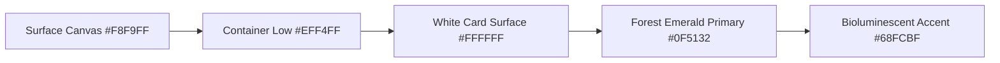

# FoodShare Design System: Premium Sustainable Logistics

**Document:** Canonical Design System Specification  
**Architecture:** Next.js 15, Tailwind CSS v4, React 19  
**Source Reference:** Google Stitch FoodShare Export Suite (`premium_sustainable_logistics/DESIGN.md`)  

---

## 1. Brand Ethos & Aesthetic

The FoodShare design system embodies the operational precision of an enterprise logistics orchestration platform fused with the grounded ethos of systemic environmental stewardship. It moves intentionally away from naive pastoral charity aesthetics, projecting instead an institutional-grade, highly dependable technological foundation.

- **Primary Brand Expression:** Forest Emerald (`#0F5132`) and Deep Forest Pine (`#003820`).
- **Data & Structure:** Clean high-density neutral backgrounds (`#F8F9FF`), crisp slate inks (`#0B1C30`, `#404942`), and subtle structural borders (`#CBD5E1` / `#C0C9C0`).
- **Typography Pairing:** Geist for UI & Headings paired with JetBrains Mono for dispatch numbers, cargo weights, and immutable audit timestamps.

---

## 2. Color System & Semantic Tokens

### Lifecycle Semantics
Every state in the food recovery pipeline enforces high-contrast, distinguishable tokens:

| Lifecycle State | Dot / Indicator | Background Tint | Text Ink Token | Semantic Meaning |
|:---|:---:|:---:|:---:|:---|
| **AVAILABLE** | `#10B981` | `#ECFDF5` | `#065F46` | Live listing staged, awaiting volunteer pickup |
| **ASSIGNED** | `#6366F1` | `#EEF2FF` | `#3730A3` | Volunteer dispatch en route to donor facility |
| **PICKED_UP** | `#F59E0B` | `#FEF3C7` | `#92400E` | Cargo onboard, cold-chain in-transit to NGO |
| **DELIVERED** | `#0EA5E9` | `#E0F2FE` | `#0369A1` | Staged at NGO receiving dock, awaiting dual sign-off |
| **COMPLETED** | `#0D9488` | `#CCFBF1` | `#115E59` | Verified received, receipt vaulted, impact booked |
| **CANCELLED** | `#F43F5E` | `#FFE4E6` | `#9F1239` | Revoked before pickup |
| **EXPIRED** | `#64748B` | `#F1F5F9` | `#334155` | Exceeded safe shelf-life window |

---

## 3. Typography & Numerical Formatting

1. **Headings & Page Titles:** Geist SemiBold / Bold with tightened letter-spacing (`-0.025em` to `-0.03em`).
2. **Body & Microcopy:** Geist Regular/Medium (`13px` to `15px`), balanced measure (45–75 characters).
3. **Data & Telemetry:** JetBrains Mono with tabular figures (`font-variant-numeric: tabular-nums`). Used strictly for:
   - Cargo weights (`240.0 kg`, `42,850 kg`)
   - Dispatch batch IDs (`#DON-4892`, `#RSC-8924`)
   - GPS telemetry (`LAT 37.7749° N / LON 122.4194° W`)
   - Real-time ETAs (`14 mins`, `14:28 EST`)

---

## 4. Layout & Responsive Geometry

- **Desktop (≥ 1280px):** 280px fixed left command sidebar (`AppSidebar`), 64px glass header bar (`AppHeader`), 24px inner gutters, max container width `1680px`.
- **Tablet (768px – 1279px):** Collapsible 64px compact icon rail or accessible drawer, responsive 8-column layout.
- **Mobile (< 768px):** Sticky top bar with hamburger drawer trigger, bottom navigation dock, single-column full-width cards, zero horizontal overflow.

