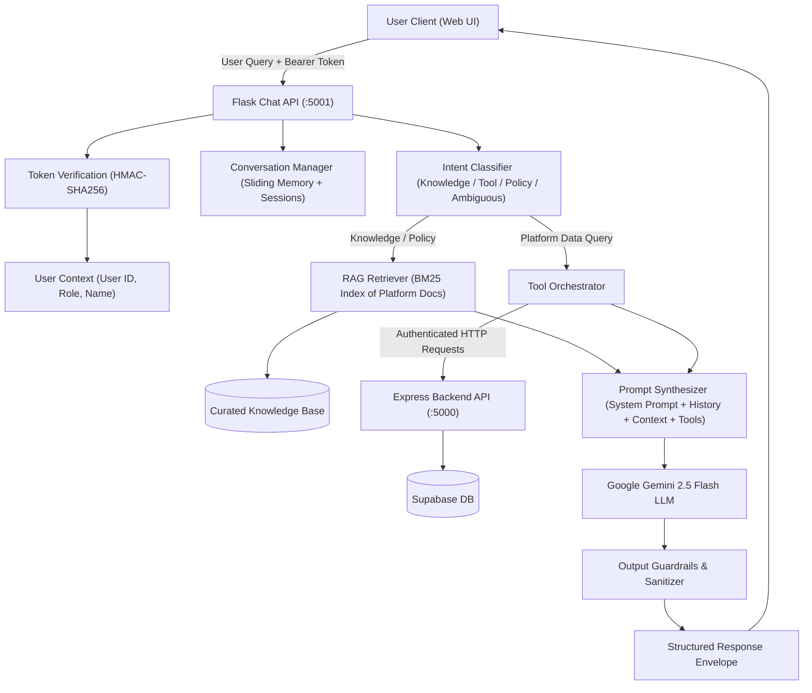

# Advanced AI Chatbot — Current State Audit & Architectural Blueprint

**Project**: Unified Food Donation Platform (SIH Hackathon)  
**Date**: November 2, 2026  
**Auditor**: Principal AI Engineer, LLM Systems Architect, Application Security Engineer & Conversational UX Designer  
**Scope**: Complete Chatbot Microservice, LLM Pipeline, Knowledge Base, Tool Integration, and Conversational Frontend  

---

## 1. Executive Summary

This comprehensive audit inspects the existing chatbot implementation across the Python Flask service (`chatbot_api/app.py`), the Next.js chat component (`frontend/src/components/Chatbot.tsx`), the Node.js/Express backend, and the Gemini API integration.

### Baseline Verdict
The existing chatbot is a **stateless, single-turn prototype with hardcoded keyword matching**. It lacks multi-turn context retention, role awareness, backend integration, conversation memory, and platform tools. While the basic HTTP error handling and rate-limiting foundations are functional, the system requires architectural transformation to become a trustworthy, context-aware, platform-integrated AI assistant.

---

## 2. Current Architecture & Implementation Inventory

### 2.1 Backend Microservice (`chatbot_api/app.py`)
- **Framework**: Flask 3.1.3 running on port 5001.
- **Endpoints**:
  - `POST /chat`: Accepts `{ "message": string }` (maximum 500 characters). Returns `{ "response": string }`.
  - `GET /health`: Returns service health and whether `GEMINI_API_KEY` is configured.
- **LLM Integration**: Direct REST `requests.post` to Gemini `generateContent` endpoint (`gemini-2.5-flash`).
- **Rate Limiting**: `flask-limiter` configured with memory storage (`10 per minute` default).
- **Knowledge Base**: In-memory Python dictionary `KNOWLEDGE_BASE` containing 11 static strings.
- **Retrieval Mechanism**: Naive substring keyword check (`any(word in query for word in ["volunteer", "pickup", "claim"])`).

### 2.2 Frontend Chat Interface (`frontend/src/components/Chatbot.tsx`)
- **Component Architecture**: Floating action button toggling a popup dialog card (384px desktop, responsive mobile width).
- **Session Handling**: Pure in-memory React state (`messages` array). Refreshing the page completely erases the chat history.
- **Role Awareness**: None. Static suggestion chips ("How do I donate food?", "How does pickup work?", "Who confirms a delivery?") are shown regardless of whether the user is a Donor, Volunteer, NGO, or Admin.
- **Message Rendering**: Plain text (`whitespace-pre-line`). No markdown formatting, code blocks, or links.

---

## 3. Critical Defects & Gap Analysis

| Category | Existing State | Gap / Risk | Required Capability |
| :--- | :--- | :--- | :--- |
| **Conversational Context** | Single-turn prompt with only current message. | Cannot answer follow-up questions ("What about tomorrow?", "Can I change it?"). | Multi-turn conversation history with sliding context window and session IDs. |
| **User Role Awareness** | Completely unaware of caller identity or role. | Gives generic advice; cannot tailor workflows to Donors vs. Volunteers vs. NGOs. | Extract verified user context from backend session token (`req.headers.Authorization`). |
| **Platform Data Integration**| Zero live data access. System prompt explicitly says "You cannot access accounts or change donations." | User cannot ask "What donations have I made?", "Where is my pickup?", or "Is my NGO verified?". | Authenticated platform tools querying backend REST APIs using the caller's session token. |
| **Knowledge Retrieval** | 10 hardcoded dictionary entries matched via simple substring checks. | Misses synonyms, nuances, and detailed policies; cannot handle multi-topic queries. | BM25 / TF-IDF ranker indexing project guides, FAQs, policies, and lifecycle rules with source attribution. |
| **Conversation Memory** | In-memory only in React component. Lost on navigation or reload. | Poor UX; no session isolation, titles, or history recall. | Server-side conversation manager with unique session IDs, titles, history retrieval, and clear/delete actions. |
| **Prompt Engineering** | Static string interpolation with simple system instructions. | Susceptible to instruction override, jailbreaks, and format inconsistency. | Structured prompt management with role conditioning, tool schemas, and output guardrails. |
| **Conversational UX** | Plain text rendering, no copy action, no timestamps, static chips. | Clunky, lacks polish, lacks accessible feedback during long operations. | Markdown rendering, copy button, role-aware suggestion pills, message timestamps, error retry. |
| **Safety & Security** | Basic `<context>` XML encapsulation. | No prompt injection detection, no PII redaction, no live data leakage protection. | Input sanitization, prompt injection defenses, sensitive data masking, and authorization validation. |

---

## 4. API Contract Comparison

### Current API Contract
```http
POST /chat
Content-Type: application/json

{
  "message": "How do I donate food?"
}
```
**Response**:
```json
{
  "response": "To donate food, register as a Donor and list surplus food..."
}
```

### Target API Contract (Full Conversational & Role-Aware)
```http
POST /api/chat
Authorization: Bearer <session_token> (Optional - guest mode if omitted)
Content-Type: application/json

{
  "conversation_id": "c7a8b9d0-1234-5678-90ab-cdef12345678",
  "message": "What is the status of my recent donations?",
  "stream": false
}
```
**Response**:
```json
{
  "conversation_id": "c7a8b9d0-1234-5678-90ab-cdef12345678",
  "response": "Here is the status of your recent donations:\n\n* **Fresh Vegetable Curry** (25 servings) — `AVAILABLE`\n* **Rice & Sambar** (50 packets) — `PICKED_UP` (in transit)\n\nWould you like details on any specific pickup?",
  "role": "Donor",
  "tools_used": ["get_user_donations"],
  "sources": [
    { "title": "Donation Lifecycle Guide", "section": "Available to Picked Up" }
  ],
  "suggested_followups": [
    "Can I cancel the vegetable curry?",
    "Who is the assigned volunteer for the rice?"
  ]
}
```

---

## 5. Architectural Blueprint for the Target System



---

## 6. Implementation Roadmap

1. **Phase B — Conversational Intelligence**: Implement modular intent classification, multi-turn dialog history, and role-conditioned reasoning.
2. **Phase C — Knowledge Base & RAG**: Build a structured, maintainable knowledge base from project documentation with BM25 retrieval and source citations.
3. **Phase D — Platform-Aware Tools**: Integrate authorized read tools (`get_my_donations`, `get_volunteer_tasks`, `get_incoming_deliveries`, `check_donation_status`) that reuse user session tokens.
4. **Phase E — Gemini Integration Engineering**: Centralized model configuration, error classification, quota handling, and robust retry logic.
5. **Phase F — Memory & Conversation Management**: Server-side conversation sessions, title generation, sliding window pruning, and history retrieval/deletion.
6. **Phase G — Frontend UX Transformation**: Role-aware suggestion pills, markdown rendering, message timestamps, copy-to-clipboard, retry failed requests, and mobile responsiveness.
7. **Phase H — Safety, Security & Redaction**: Strict prompt injection defenses, PII masking, and role access verification.
8. **Phase I & J — Evaluation, Testing & Observability**: Automated 18-point evaluation suite, latency tracking, and structured monitoring.

---
*Audit complete. Proceeding to implementation phases.*

