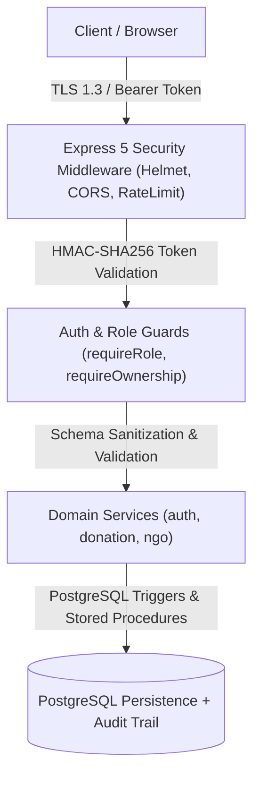

# Unified Food Donation Platform — Security & Privacy Policy

**Version**: 1.0.0 Release Candidate  
**Date**: November 2, 2026  
**Auditor**: Application Security Engineer & Data Protection Officer  

---

## 1. Security Architecture Overview

The Unified Food Donation Platform enforces defense-in-depth across the client interface, API gateway, domain service layer, and database storage layer.

---

## 2. Authentication & Session Security

- **Token Mechanism**: HMAC-SHA256 signed session tokens generated with `crypto.createHmac`.
- **Token Claims**: Contains `userId`, `email`, `role`, `iat`, `exp` (24-hour expiration), and unique `jti` (UUID).
- **Anti-Tampering**: Verified using constant-time comparison (`crypto.timingSafeEqual`) to eliminate timing attacks.
- **Revocation / Logout**: Server maintains an in-memory token revocation blocklist (`revokeToken`). Revoked tokens are immediately rejected by `authMiddleware`.
- **Password Hashing**: Passwords hashed using `bcrypt` with work factor 12 (`BCRYPT_ROUNDS = 12`). Minimum length is 6 characters; maximum is 72 bytes (preventing bcrypt silent truncation attacks).

---

## 3. Role-Based Access Control (RBAC) & Ownership Guards

Four distinct platform roles are enforced:
1. `Donor`: Allowed to create listings, read own listings (`/donations/mine`), update permitted details while `AVAILABLE`, and cancel before pickup.
2. `Volunteer`: Allowed to browse unexpired `AVAILABLE` donations, claim listings via atomic stored procedure, confirm pickup, and record delivery to verified NGOs.
3. `NGO`: Allowed to submit verification documents, view deliveries specifically addressed to their organization, and execute receipt confirmation.
4. `Admin`: Oversight role allowed to approve/reject NGO verifications, review system-wide audit activity, inspect user directories, and expire donations.

### Administrative Privilege Safety Rules:
- **No Self-Suspension**: Administrators are prevented by backend validation from changing their own `account_status`.
- **No Peer Admin Mutation**: Administrators cannot alter the role, status, or details of other administrator accounts.
- **Strict User Status Whitelist**: Account status transitions are strictly restricted to `active`, `suspended`, and `rejected`.

---

## 4. Input Validation & Data Protection

- **Server-Side Validation**: Every endpoint validates input types, lengths, and formats. Client-side validation is never relied upon as a sole defense.
- **Profile Updates (`PATCH /api/v1/auth/me`)**: Rejects immutable security fields (`email`, `role`, `id`, `account_status`, `password`), enforces phone number formatting (`^[+]?[0-9\s\-()]{5,30}$`), and postal code validation (`^[a-zA-Z0-9\s\-]{3,20}$`).
- **PostgREST Injection Protection**: Filter values (`search`, `area`, `pincode`) are sanitized by stripping characters (`[,()%\\"]`) to prevent PostgREST parameter injection.
- **Database Domain Checks**: PostgreSQL check constraints enforce food pickup deadlines (`pickup_deadline <= expires_at`), coordinate validity (`-90..90`, `-180..180`), and positive donation quantities.

---

## 5. Audit Logging & Compliance

- **Immutable Audit Records**: Critical operations are stored in the `audit_logs` table with `actor_id`, `action`, `resource_type`, `resource_id`, `reason`, `metadata`, and `created_at`.
- **Instrumented Events**:
  - `donation.created`
  - `donation.claimed`
  - `donation.picked_up`
  - `donation.delivered`
  - `donation.completed`
  - `donation.cancelled`
  - `donation.expired`
  - `ngo.verification_reviewed`
  - `user.status_changed`
- **Data Minimization & Privacy**:
  - Audit logs record operational metadata only.
  - Passwords, password hashes, session tokens, and financial or private biometric data are never written to audit records.
  - Fail-safe execution: Audit log failures do not interrupt primary business workflows.

---

## 6. Secret Management & Infrastructure

- **Environment Isolation**: All credentials (`SUPABASE_KEY`, `SESSION_SECRET`, `GEMINI_API_KEY`) are managed strictly via environment variables.
- **No Secrets in Client Bundles**: Next.js client-exposed variables are restricted to `NEXT_PUBLIC_*` URLs. Service role keys and secrets are never bundled into client JS.
- **Git Hygiene**: `.gitignore` strictly excludes `.env`, `.env.local`, `.env.production`, and credential caches.

---

## 7. Known Limitations & Recommendations

1. **Clustered Rate Limiting**: The current rate limiter and token revocation blocklist operate in-process memory. When scaled horizontally across multiple servers or serverless instances, a shared Redis instance should back `rateLimit.js` and `token.js`.
2. **Direct Client RLS**: The backend API connects using Supabase service role privileges and performs application-tier authorization. If clients are configured to query Supabase directly in future versions, RLS policies must be linked to Supabase Auth JWTs.

---
*Security and Privacy Policy verified for v1.0.0 Release Candidate.*

