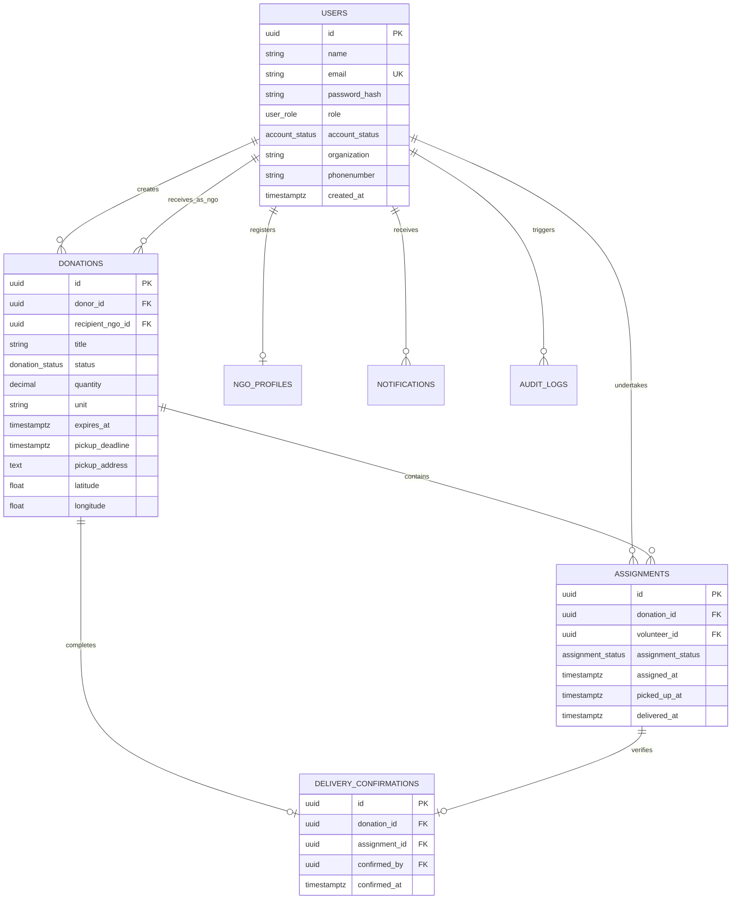
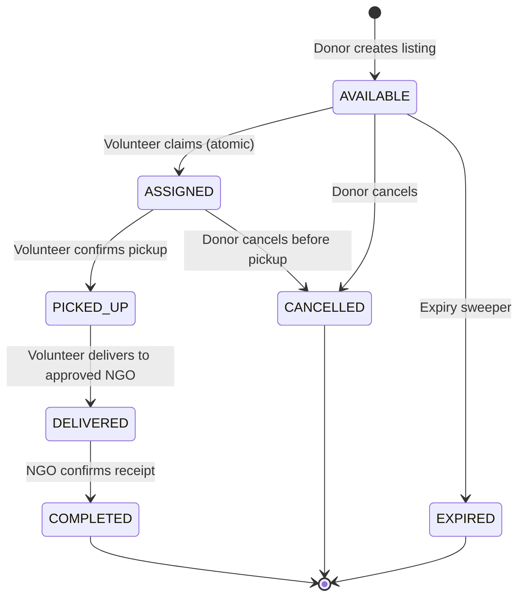
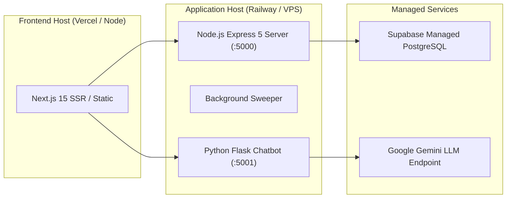

# Unified Food Donation Platform — System Architecture

**Project**: Unified Food Donation Platform (SIH Hackathon)  
**Version**: 1.0.0 Release Candidate  
**Date**: November 2, 2026  
**Architect**: Principal Full-Stack Architect & System Engineer  

---

## 1. High-Level Architecture Overview

The Unified Food Donation Platform connects food donors (restaurants, caterers, households), volunteers, and verified NGOs through an automated, time-sensitive donation and distribution lifecycle. 

The system is engineered as a decoupled modern full-stack web application with three primary tiers and an auxiliary AI chatbot microservice:

```mermaid
graph TD
    User["Web Client / Browser (Desktop & Mobile)"] -->|HTTPS / REST API| Frontend["Next.js 15 Frontend (App Router, React 19)"]
    Frontend -->|HTTP / JSON (Envelope)| Backend["Express 5 Node.js API (Port 5000)"]
    Frontend -->|HTTP / JSON| Chatbot["Python Flask Chatbot (Port 5001)"]
    Chatbot -->|REST API / HTTPS| Gemini["Google Gemini 2.5 Flash API"]
    Backend -->|REST / PostgREST| Supabase["Supabase Cloud / Postgres Database"]
    Frontend -->|Client Geocoding| OpenCage["OpenCage Geocoding API"]
```

---

## 2. Frontend Architecture

- **Framework**: Next.js 15.5.3 with React 19.1.0 and TypeScript 5.
- **Styling & Design Tokens**: Tailwind CSS v4 (`@tailwindcss/postcss`) using the Organic Modern / Indian Kitchens design tokens declared in `src/app/globals.css`.
- **UI Architecture**:
  - `AppShell.tsx`: Role-aware global application layout with top navigation header (`AppNav.tsx`), user profile pill, notifications badge, and mobile tab bar.
  - `AuthLayout.tsx`: Two-panel editorial layout for authentication views.
  - Primitives: Shadcn-inspired accessible component primitives built with Radix UI (`DropdownMenu`, `Tabs`, `Label`, `Slot`) and Lucide React icons.
- **Client State & API Layer**:
  - `api-client.ts`: Centralized Axios instance with request and response interceptors.
  - `api-envelope.ts`: Unwraps backend v1 standard envelopes (`{ data, meta }`) and provides typed `getApiError()` handling for errors (`{ error: { code, message, details } }`).
  - `session.ts`: Client-side JWT session storage, role parsing, and profile state synchronization.
  - `use-resource.ts`: Hook for declarative asynchronous data fetching with automatic cache invalidation, deduplication, and stale-response suppression.
  - `geo.ts`: Location lookup abstraction using HTML5 Geolocation API with OpenCage reverse geocoding and fallback to manual entry.

---

## 3. Backend Architecture

- **Runtime & Framework**: Node.js v26 with Express 5.1.0 (utilizing native Promise rejection error handling).
- **Security & Middleware Stack**:
  - `helmet`: HTTP security headers.
  - `cors`: Strict allowed origins from `CORS_ORIGIN` with credentials support.
  - `rateLimit.js`: Sliding-window in-memory rate limiter on sensitive authentication routes.
  - `authenticate.js`: Bearer token extraction, HMAC-SHA256 signature verification, expiry verification, and in-memory revocation blocklist check.
  - `authorize.js`: Role-based route guards (`requireRole`) and ownership guards (`requireDonationOwnership`, `requireApprovedNGO`).
  - `errorHandler.js`: Centralized error handler returning structured `{ error: { code, message, details }, meta: { requestId } }`.
- **Domain Services**:
  - `auth.service.js`: Registration, login, profile retrieval, profile updates with schema validation.
  - `donation.service.js`: Complete 7-state donation lifecycle machine, atomic claim dispatch, and expiry sweeping.
  - `ngo.service.js`: NGO registration verification, approval review, and incoming delivery queries.
  - `notification.service.js`: In-app notification creation, read status, and structured audit logging.
  - `impact.service.js`: Verified metrics aggregation based strictly on `COMPLETED` donations.
- **Background Jobs**:
  - `index.js`: In-process background timer (`EXPIRY_SWEEPER`) running at 5-minute intervals to automatically transition overdue available donations to `EXPIRED`.

---

## 4. Database Architecture & Concurrency Design

- **Engine**: Supabase PostgreSQL 15+ with extensions `uuid-ossp` and `pgcrypto`.
- **Entity Relationship Model**:



### Atomic Database Functions & Triggers:
1. `claim_donation(p_donation_id, p_volunteer_id)`:
   - Uses `SELECT ... FOR UPDATE` row locking.
   - Ensures only one active volunteer can claim a donation; simultaneous claims serialize safely.
2. `confirm_receipt(p_donation_id, p_ngo_id)`:
   - Validates that the calling NGO matches `recipient_ngo_id`.
   - Atomically updates donation to `COMPLETED`, assignment to `completed`, and inserts `delivery_confirmations`.
3. `enforce_donation_status_transition_trigger`:
   - PostgreSQL `BEFORE UPDATE` trigger enforcing valid lifecycle transitions directly in the database.

---

## 5. Donation Lifecycle State Machine



- **Transitions Allowed**:
  - `AVAILABLE` -> `ASSIGNED`, `CANCELLED`, `EXPIRED`
  - `ASSIGNED` -> `PICKED_UP`, `CANCELLED`
  - `PICKED_UP` -> `DELIVERED`
  - `DELIVERED` -> `COMPLETED`
- **Cancellation Rule**: Allowed strictly while in `AVAILABLE` or `ASSIGNED` (before physical food pickup).
- **Completion Rule**: Requires receipt confirmation by the specific NGO addressed during delivery.

---

## 6. Authentication & Authorization Architecture

- **Session Tokens**: Stateless tokens signed with HMAC-SHA256 (`backend/lib/token.js`).
- **Token Claims**:
  - `userId`: UUID of authenticated user.
  - `email`: User's primary email.
  - `role`: Role (`Donor`, `Volunteer`, `NGO`, `Admin`).
  - `jti`: Unique UUID preventing token replay.
  - `iat`: Timestamp issued.
  - `exp`: Timestamp 24 hours in the future.
- **Revocation**: Handled via in-memory server blocklist upon `POST /api/v1/auth/logout`.
- **Authorization Enforcement**:
  - Role-based access control (`requireRole`) protects administrative, volunteer, donor, and NGO routes.
  - Ownership middleware (`requireDonationOwnership`, `requireAssignmentOwnership`) ensures donors can only modify their own listings and volunteers can only modify their active tasks.

---

## 7. AI Chatbot Microservice Architecture

- **Framework**: Python Flask 3.1.3 on port 5001.
- **Model Integration**: Google Gemini API via `gemini-2.5-flash`.
- **Knowledge Base**: Curated platform facts (`KNOWLEDGE_BASE`), donation guidelines, food categories, role responsibilities, and impact rules.
- **Safety & Rate Limiting**:
  - In-memory rate limiting: 10 requests per minute per IP.
  - Input length limit: Maximum 500 characters.
  - Structured XML prompt encapsulation prevents prompt injection.
  - Fallback: Graceful 503 response (`CHATBOT_NOT_CONFIGURED`) when provider credentials are missing.

---

## 8. Deployment Architecture



---
*System Architecture specification verified against live codebase.*

