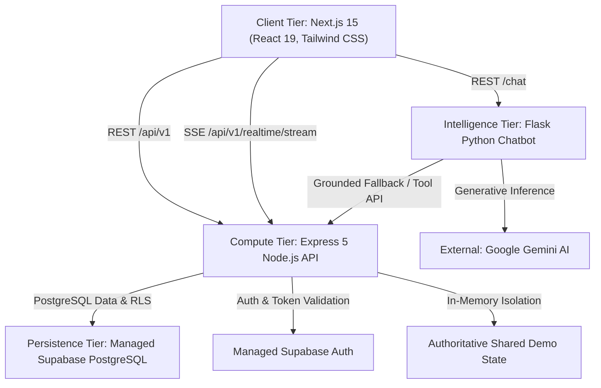

# FoodShare Infrastructure — 00. Architecture Baseline

## 1. System Topology Overview

FoodShare is architected as a hybrid platform distributed across specialized compute, persistence, and intelligence layers:

---

## 2. Component Inventory

### A. Presentation Layer (Frontend)
- **Framework**: Next.js 15.5.3 (React 19.1.0, TypeScript 5.8)
- **Styling**: Tailwind CSS v4 inline theme architecture
- **State Management**: SWR-style custom resource hook (`useResource`), external synchronization stores (`useSyncExternalStore`), native SSE client (`useRealtimeStatus`, `useRealtimeEvent`)
- **Rendering Model**: App Router, hybrid SSR and client-side reactive components
- **Network Client**: Axios with 2.5s idempotent cache, in-flight deduplication, and auth token interception

### B. Core Application Service (Backend API)
- **Runtime**: Node.js v26.12.1 (ES Modules)
- **Framework**: Express 5.1.0
- **Primary Persistence Client**: `@supabase/supabase-js` v2.49.1
- **Security & Authorization**: HMAC-SHA256 session token engine, role-based access control middleware (`requireRole`), rate limiting middleware
- **Real-Time Communication**: Server-Sent Events (SSE) bus with client connection tracking, tenant filtering, and automatic heartbeat pinging
- **Demo Mode**: In-memory ACID-compliant isolated state machine supporting multi-role concurrency without cross-environment contamination

### C. Conversational Intelligence Microservice (Chatbot)
- **Runtime**: Python 3.12 (WSGI ready)
- **Framework**: Flask 3.1.0, Flask-CORS, Flask-Limiter
- **LLM Engine**: Google Gemini API via `google-generativeai` with deterministic fallback knowledge synthesizer
- **Knowledge Base**: Domain-specific food safety (FDA Food Code, Good Samaritan Act, cold-chain temperature thresholds, donation taxonomy)
- **Security**: Prompt injection sanitizer, role-aware query bounds, rate-limited endpoints

### D. Data & Access Control Tier (Supabase PostgreSQL)
- **Engine**: Managed PostgreSQL 15+
- **Security Model**: Row Level Security (RLS) enabled across `users`, `donations`, `assignments`, `delivery_confirmations`, `notifications`, `audit_logs`
- **Integrity**: Foreign keys with cascading constraints, domain check constraints, transactional lifecycle verification
- **Indexes**: Primary key B-trees, foreign keys, reverse chronological timestamps, partial indexes on active volunteer assignments

---

## 3. Operational Environment Designations

| Dimension | Production Mode | Shared Demo Mode |
|---|---|---|
| **Identity & Auth** | Supabase Auth + Database User Ledger | Pre-seeded Deterministic Demo Accounts (`d0000000-...`) |
| **Data Authoritative Source** | Supabase PostgreSQL tables | Isolated in-memory `demoStore` with transactional lifecycle |
| **Realtime Stream Filter** | `client.isDemo === false` | `client.isDemo === true` (Strict tenant isolation) |
| **Persistence Across Restarts** | Permanent in PostgreSQL | In-memory with deterministic seed factory & manual reset API |
| **External Cloud Requirement** | Internet connection to Supabase & Gemini | 100% offline-capable local execution |

