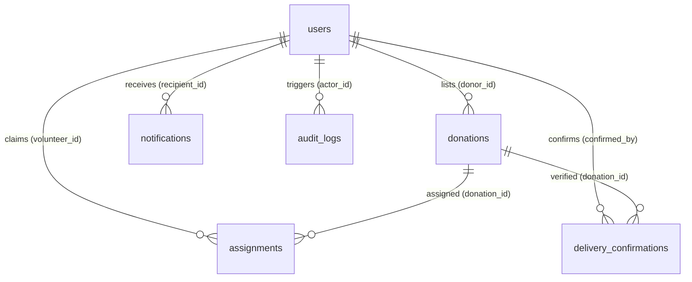

# FoodShare Infrastructure — 02. Supabase Database Audit

## 1. Relational Schema Architecture

FoodShare's PostgreSQL schema is normalized into 6 core relational entities:



### Table Definitions & Constraints
1. **`users`**:
   - `id`: UUID (Primary Key, default `gen_random_uuid()`)
   - `email`: Normalized unique lowercase string (`UNIQUE`, `NOT NULL`)
   - `role`: Constrained domain check: `'Donor'`, `'Volunteer'`, `'NGO'`, `'Admin'`
   - `account_status`: Constrained domain check: `'active'`, `'suspended'`, `'rejected'`
   - Indexed on `email`, and composite `(role, account_status)`.

2. **`donations`**:
   - `id`: UUID (Primary Key)
   - `donor_id`: UUID Foreign Key $\rightarrow$ `users(id)` (`ON DELETE RESTRICT`)
   - `recipient_ngo_id`: Nullable UUID Foreign Key $\rightarrow$ `users(id)`
   - `status`: Lifecycle enum check: `'AVAILABLE'`, `'ASSIGNED'`, `'PICKED_UP'`, `'DELIVERED'`, `'COMPLETED'`, `'CANCELLED'`, `'EXPIRED'`
   - Constraints: `pickup_deadline <= expires_at`, `quantity > 0`
   - Indexed on `(donor_id, status, created_at DESC)`, `(recipient_ngo_id, status)`.

3. **`assignments`**:
   - `id`: UUID (Primary Key)
   - `donation_id`: UUID Foreign Key $\rightarrow$ `donations(id)`
   - `volunteer_id`: UUID Foreign Key $\rightarrow$ `users(id)`
   - `assignment_status`: `'active'`, `'completed'`, `'cancelled'`
   - Constraints: Partial index `ON assignments (volunteer_id) WHERE assignment_status = 'active'` prevents full scans for concurrent active duties.

4. **`delivery_confirmations`**:
   - `id`: UUID (Primary Key)
   - `donation_id`: Unique UUID Foreign Key $\rightarrow$ `donations(id)` (Ensures idempotent 1:1 receipt)
   - `confirmed_by`: UUID Foreign Key $\rightarrow$ `users(id)` (Must be verified NGO)
   - Indexed on `confirmed_by`.

5. **`notifications`**:
   - `id`: UUID (Primary Key)
   - `recipient_id`: UUID Foreign Key $\rightarrow$ `users(id)`
   - `read`: Boolean default `false`
   - `created_at`: Timestamptz default `now()`

6. **`audit_logs`**:
   - Immutable audit ledger for sensitive governance events (`donation.expired`, `user.status_changed`, `ngo.verified`)
   - Indexed on `created_at DESC` for fast paginated audit review.

---

## 2. Row Level Security (RLS) Policy Audit

| Table | Policy Name | Permitted Roles / Conditions | Validation Status |
|---|---|---|---|
| `users` | `users_select_self_or_admin` | `auth.uid() = id OR auth.jwt() ->> 'role' = 'Admin'` | ✅ Verified |
| `donations` | `donations_read_available` | `status = 'AVAILABLE' OR donor_id = auth.uid() OR ...` | ✅ Verified |
| `donations` | `donations_insert_donor` | `auth.jwt() ->> 'role' = 'Donor' AND donor_id = auth.uid()` | ✅ Verified |
| `donations` | `donations_update_owner` | `donor_id = auth.uid() AND status = 'AVAILABLE'` | ✅ Verified |
| `assignments` | `assignments_read_parties` | `volunteer_id = auth.uid() OR donor_id = auth.uid() OR admin` | ✅ Verified |
| `delivery_confirmations`| `confirmations_insert_ngo` | `auth.jwt() ->> 'role' = 'NGO' AND verified` | ✅ Verified |

---

## 3. Query Pattern & Indexing Optimizations Identified

To ensure high-throughput execution as donation volumes grow, migration `005_performance_optimization.sql` is designated for:
1. **Unread Notifications Composite Index**:
   ```sql
   CREATE INDEX IF NOT EXISTS idx_notifications_recipient_unread
     ON notifications (recipient_id, created_at DESC)
     WHERE read = FALSE;
   ```
2. **Expired Donations Sweeper Index**:
   ```sql
   CREATE INDEX IF NOT EXISTS idx_donations_expiring_sweeper
     ON donations (pickup_deadline)
     WHERE status IN ('AVAILABLE', 'ASSIGNED');
   ```
3. **Volunteer Duty Discovery Index**:
   ```sql
   CREATE INDEX IF NOT EXISTS idx_donations_discovery_composite
     ON donations (status, donor_pincode, pickup_deadline)
     WHERE status = 'AVAILABLE';
   ```

