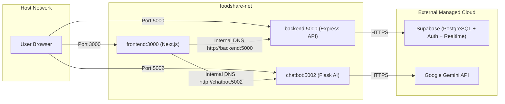

# FoodShare Infrastructure — 04. Docker Readiness & Containerization Audit

## 1. Containerization Audit & Target Specifications

| Component | Current Host Runtime | Target Container Base Image | Production Server | Container Port | Non-Root User |
|---|---|---|---|---|---|
| **Express Backend** | Node.js v26.12.1 | `node:20-alpine` (LTS) | `node index.js` | `5000` | `node` (UID 1000) |
| **Flask Chatbot** | Python 3.12 | `python:3.12-slim` | `gunicorn` (WSGI) | `5002` | `appuser` (UID 1001) |
| **Next.js Frontend** | Next.js 15.5.3 | `node:20-alpine` (Multi-stage) | `node server.js` (Standalone) | `3000` | `nextjs` (UID 1001) |

---

## 2. Readiness Evaluation by Service

### A. Express Backend (`backend/`)
- **Readiness**: High.
- **Dependencies**: Express 5, `@supabase/supabase-js`, `bcrypt`, `cors`, `dotenv`.
- **Package Management**: Uses deterministic `package-lock.json` and `npm ci --omit=dev`.
- **Signal Handling**: Express `index.js` already implements `process.on("SIGTERM")` and `process.on("SIGINT")` for graceful socket closing.
- **Healthcheck**: `GET /api/v1/health` returns status JSON within 5ms.

### B. Flask Chatbot (`chatbot_api/`)
- **Readiness**: High.
- **Dependencies**: Flask, Flask-CORS, Flask-Limiter, google-generativeai, python-dotenv, gunicorn.
- **Production Server Transition**: Development currently runs `python app.py` (Flask internal server). Container image will execute with `gunicorn --bind 0.0.0.0:5002 --workers 2 --threads 4 --timeout 60 app:app`.
- **Healthcheck**: `GET /health` probe natively supported.

### C. Next.js Frontend (`frontend/`)
- **Readiness**: High with standalone output configuration.
- **Configuration**: Needs `output: "standalone"` added to `next.config.ts` so Next.js automatically packages minimal server files into `.next/standalone` without requiring full `node_modules` at runtime.
- **Build Strategy**: Multi-stage build (`deps` $\rightarrow$ `builder` $\rightarrow$ `runner`), trimming final image size from ~1.2 GB to ~140 MB.

---

## 3. Docker Compose Network Topology

