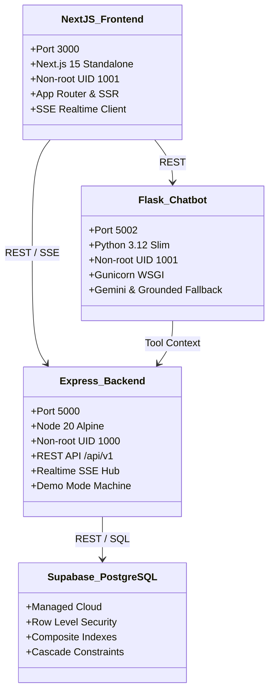

# FoodShare Infrastructure — 05. Target Hybrid Architecture

## 1. Architectural Principles

1. **Separation of Concerns**:
   - **Docker**: Containerization, process isolation, environment parity, and unified orchestration.
   - **Supabase**: Managed PostgreSQL transactional storage, row-level security (RLS), and identity management.
   - **Express**: Application logic, donation state machines, lifecycle transitions, authorization middleware, and high-frequency SSE event hub.
   - **Flask & Gemini**: Domain-specific conversational assistance and food safety guidance.
   - **Next.js**: Presentation layer, role-specific UI workflows, and reactive client state.

2. **No Second Database**:
   - We do not run a second PostgreSQL container inside Docker that fragments production truth.
   - Supabase remains the single authoritative source of persistent data.
   - Local development and Demo Mode leverage the ACID-compliant, memory-isolated `demoStore` or local Supabase CLI when configured.

3. **Strict Zero-Trust Security**:
   - Supabase Service Role keys are **never** bundled into Docker client images or frontend bundles.
   - Browser communication uses short-lived tokens and strictly constrained anon keys.
   - All backend containers execute under dedicated non-root system users (`node`, `appuser`, `nextjs`).

---

## 2. Target Component Specifications

---

## 3. Communication & Contract Specifications

- **Client $\rightarrow$ Backend**: All REST endpoints standardized under `/api/v1/` returning `{ data, meta: { requestId } }` or `{ error: { code, message, details? }, meta }`.
- **Client $\leftrightarrow$ Realtime Hub**: Native Server-Sent Events via `GET /api/v1/realtime/stream?token=...` with automatic reconnect and keep-alive pinging.
- **Client $\rightarrow$ Chatbot**: JSON payload `{ message, conversation_id? }` returning `{ answer, followups, citations }`.
- **Backend $\rightarrow$ Database**: Parameterized Supabase client with connection resilience and degraded mode safety.

