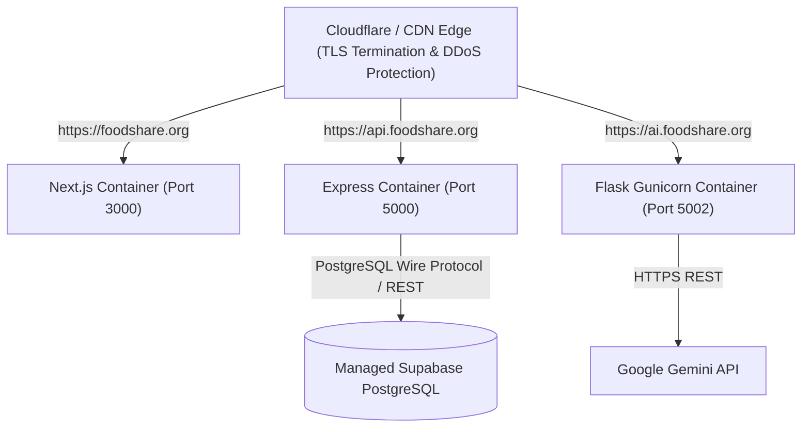

# FoodShare Infrastructure — 11. Production Deployment Guide

## 1. Production Architecture Overview

In production, FoodShare follows an optimized hybrid topology:
- **Presentation Layer**: Containerized Next.js standalone runner or managed edge deployment (e.g. Vercel, Railway, Cloud Run).
- **Core API Layer**: Containerized Express 5 microservice on an autoscaling container runner with persistent HTTP/SSE connection support.
- **AI Microservice**: Containerized Flask microservice behind Gunicorn WSGI.
- **Data & Identity**: Managed Supabase PostgreSQL instance with Row Level Security (RLS) and automated daily point-in-time recovery.



---

## 2. Step-by-Step Deployment Procedure

### Step 1: Database Migration Deployment
Apply all numbered SQL migrations in sequence against the production Supabase instance:
```bash
# Using Supabase CLI:
supabase db push

# Or execute migrations in sequence:
# 1. 001_initial_schema.sql
# 2. 002_audit_hardening.sql
# 3. 003_fix_confirm_receipt_ambiguity.sql
# 4. 004_performance_indexes.sql
# 5. 005_performance_optimization.sql
```

### Step 2: Secret Configuration
Inject environment variables securely into your container orchestrator:
- `NODE_ENV=production`
- `SUPABASE_URL=https://<your-project>.supabase.co`
- `SUPABASE_KEY=<your-production-anon-key>`
- `SESSION_SECRET=<minimum-32-char-random-secret>`
- `GEMINI_API_KEY=<your-production-gemini-key>`
- `CORS_ORIGIN=https://foodshare.org`

### Step 3: Container Image Builds
```bash
# Build production multi-stage images
docker build -t foodshare/backend:v1.0.0 ./backend
docker build -t foodshare/chatbot:v1.0.0 ./chatbot_api
docker build -t foodshare/frontend:v1.0.0 ./frontend
```

### Step 4: Healthcheck Probing
Configure container orchestrator probes:
- **Express Backend Probe**: `HTTP GET /api/v1/health` (Expects HTTP 200 within 5 seconds)
- **Chatbot Probe**: `HTTP GET /health` (Expects HTTP 200 within 5 seconds)
- **Frontend Probe**: `HTTP GET /api/health` (Expects HTTP 200 within 5 seconds)

---

## 3. Disaster Recovery & Zero-Downtime Rollouts

1. **Rolling Deployments**: Deploy backend containers with `maxSurge=1` and `maxUnavailable=0`. The active health checks guarantee that previous revisions are only terminated once the new container reports `status: "healthy"`.
2. **Graceful Draining**: The Express backend captures `SIGTERM` signals and allows in-flight HTTP requests and SSE streams up to 10 seconds to finish before terminating.
3. **Point-In-Time Database Restore**: Managed Supabase PostgreSQL maintains write-ahead logs (WAL) allowing point-in-time recovery to any second within the retention window.

