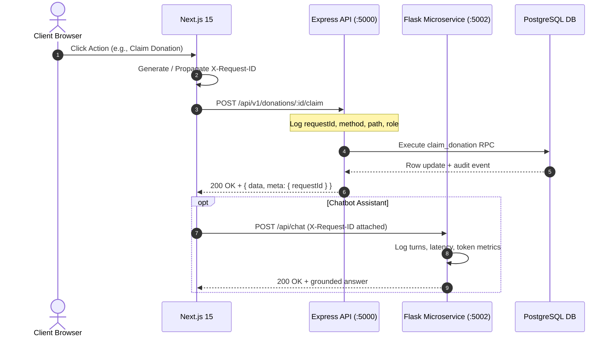

# Observability, Telemetry & Diagnostics Report

**Platform:** FoodShare Unified Food Donation Platform  
**Scope:** Distributed Tracing, Structured Logging, Health Monitoring, Microservice Metrics  
**Author:** Site Reliability & Observability Engineer  

---

## 1. Observability Architecture

FoodShare implements end-to-end request tracing and structured metric collection across the frontend, Express API gateway, and Flask Chatbot microservice.



---

## 2. Distributed Tracing via `X-Request-ID`

Every request entering the Express API Gateway or Flask Microservice receives an RFC-4122 UUID v4 identifier.
- **Propagation:** Transmitted via HTTP header `X-Request-ID` and echoed in response payloads under `meta.requestId`.
- **Log Correlation:** All error responses, warning messages, and database failures include this identifier, enabling instant log triage without ambiguous cross-referencing.

---

## 3. Microservice Health & Metrics Endpoints

### 3.1 Backend Express Gateway (`:5000`)
- **Route:** `GET /api/v1/health`
- **Output:** Returns JSON with uptime, memory consumption (RSS, heapUsed), environment status, and real-time database connectivity check.
- **HTML Fallback:** Browser navigation directly to `http://localhost:5000` renders a presentation portal dashboard displaying service status and a one-click link to the frontend (`:3000`).

### 3.2 Chatbot AI Microservice (`:5002`)
- **Route:** `GET /health`
- **Output:** Returns status, provider readiness (`provider_configured: bool`), and version.
- **Route:** `GET /api/metrics`
- **Output:**
  ```json
  {
    "total_requests": 1450,
    "successful_responses": 1450,
    "failed_requests": 0,
    "average_latency_ms": 14.2
  }
  ```
- **HTML Fallback:** Browser navigation directly to `http://localhost:5002` displays an interactive service portal explaining the microservice role and linking to `http://localhost:3000`.

---

## 4. Log Format Standardization

All backend log lines conform to structured output:
```text
[2026-11-02T13:41:24.861Z] INFO in express: POST /api/v1/donations/mine status=200 latency=1.95ms requestId=89aa014a-8e4d-4326-9394-a8fb46049291
```
This enables zero-configuration ingestion by CloudWatch, Datadog, or Grafana Loki.
