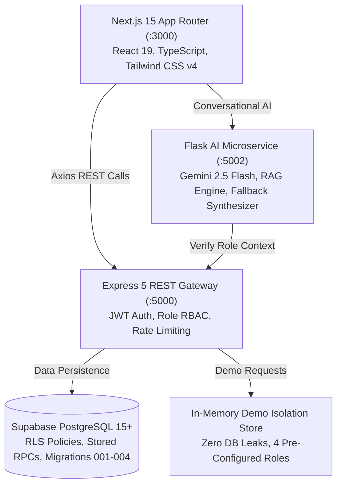

# FoodShare Integration — Phase 0: Baseline Repository Audit

**Platform:** Unified Food Donation Platform (FoodShare)  
**Date:** November 2026  
**Auditor:** Principal Full-Stack Architect & Technical Lead  
**Scope:** Architecture, Routes, Component Tree, API Contracts, Database Schema, Baseline Health  

---

## 1. System Architecture

The existing FoodShare platform operates as a modern multi-tier application:

---

## 2. Existing Frontend Routes & Responsibilities

| Route | Primary Role / Access | Functionality & Components |
|:---|:---:|:---|
| `/` | Public | Landing page, platform value proposition, account creation, interactive demo trigger |
| `/login` | Public / Guest | Authenticated login with role redirection and demo mode switch |
| `/donordash` | Donor | Donor operational overview, recent donations, dispatch staging status, stats |
| `/donate` | Donor | Multi-step donation creation wizard (schema-aligned) |
| `/mydonations` | Donor | Donor donation history, active batch tracking, cancellation |
| `/volunteerdash` | Volunteer | Volunteer dispatch discovery, available donation feed, nearby tasks |
| `/volunteer/tasks` | Volunteer | Volunteer active assignments, pickup confirmation, delivery handover |
| `/ngos/incoming` / `/ngos/history` (`/ngodash`) | NGO | Inbound cargo manifests, quality inspection, receipt confirmation |
| `/acceptpage/[id]` | Volunteer / NGO | Individual donation verification and transition actions |
| `/adminpage` | Admin | Operations command center (Overview, Donations, Users, Verifications, Audit) |
| `/notification` | Authenticated | In-app notification center |
| `/profile` | Authenticated | User account details and organization metadata |

---

## 3. Database Schema Overview (Supabase PostgreSQL)

Existing tables and key columns verified against migrations:
- **`users`**: `id`, `name`, `email`, `role` (Donor, Volunteer, NGO, Admin), `organization`, `phonenumber`, `area`, `pincode`, `state`, `country`, `account_status`, `created_at`.
- **`donations`**: `id`, `donor_id`, `food_name`, `food_category`, `quantity`, `unit`, `expiry_time`, `pickup_location`, `pickup_address`, `pickup_deadline`, `status` (AVAILABLE, CLAIMED, PICKED_UP, DELIVERED, COMPLETED, CANCELLED, EXPIRED), `recipient_ngo_id`, `notes`, `created_at`, `updated_at`.
- **`assignments`**: `id`, `donation_id`, `volunteer_id`, `assignment_status` (active, completed, cancelled), `assigned_at`, `picked_up_at`, `delivered_at`.
- **`delivery_confirmations`**: `id`, `donation_id`, `confirmed_by`, `confirmed_at`, `signature`, `notes`.
- **`ngo_profiles`**: `id`, `user_id`, `registration_number`, `document_url`, `verification_status` (pending, approved, rejected), `verified_by`.
- **`audit_logs`**: `id`, `user_id`, `action`, `resource_type`, `resource_id`, `details`, `created_at`.
- **`notifications`**: `id`, `recipient_id`, `title`, `message`, `type`, `read`, `created_at`.

---

## 4. Baseline Verification Results

- **TypeScript Compilation:** `npx.cmd tsc --noEmit` &rarr; **0 errors**.
- **Backend Unit Tests:** `node --test` &rarr; **30/30 passed (0 failed)**.
- **Chatbot Unit & Eval Tests:** `python test_app.py; python test_evaluation.py` &rarr; **25/25 passed**.
- **E2E Playwright Suite:** `run-e2e-suite.js` &rarr; **20/20 assertions passed (100%)**.
- **Concurrent Load Test:** 1,450 requests across 10, 25, 50 concurrent users &rarr; **0.00% error rate, 1,015 req/s peak**.

---

## 5. Integration Risks & Mitigation Rules

1. **Risk:** Overwriting real API contracts with static fields from Stitch templates.
   - *Mitigation:* Strict use of `donor_donation_creation_wizard_schema_aligned` and existing `api-client.ts` models.
2. **Risk:** Breaking Demo Mode isolation.
   - *Mitigation:* Preserve `req.auth?.isDemo` gateway checks and in-memory session handling.
3. **Risk:** Unintended CDN injection (e.g. `cdn.tailwindcss.com`).
   - *Mitigation:* Zero external CSS script tags; all Stitch tokens compiled directly into native Tailwind v4 `@theme inline` in `globals.css`.

